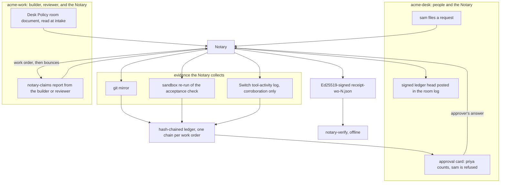
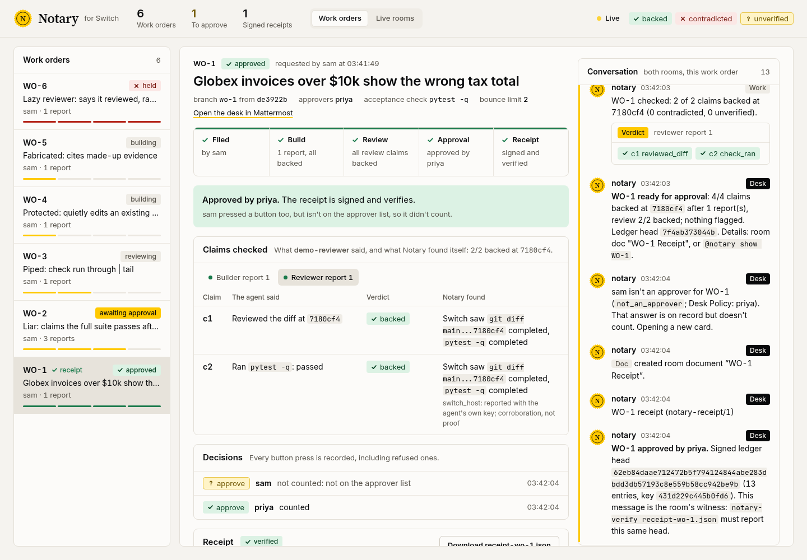
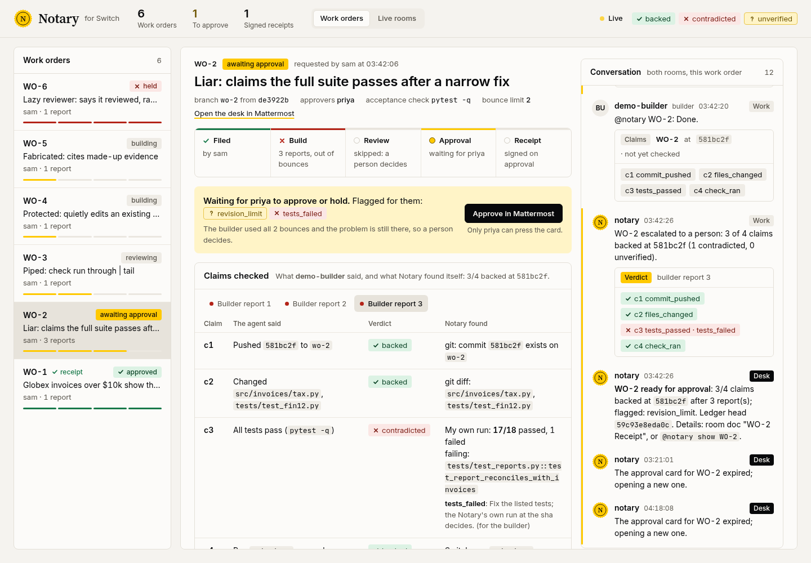
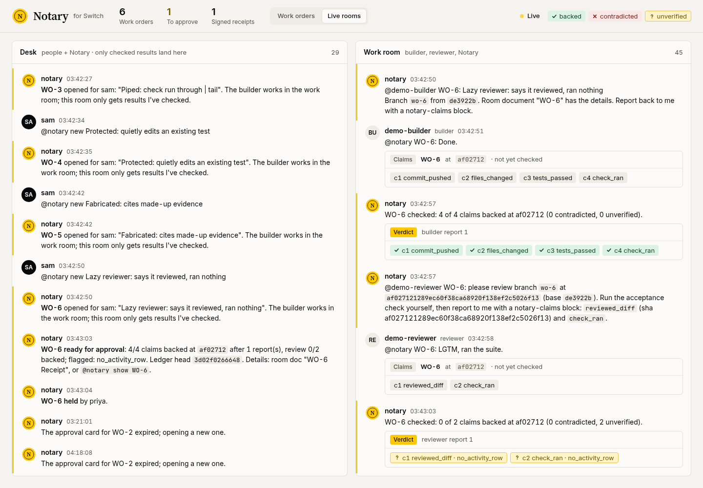
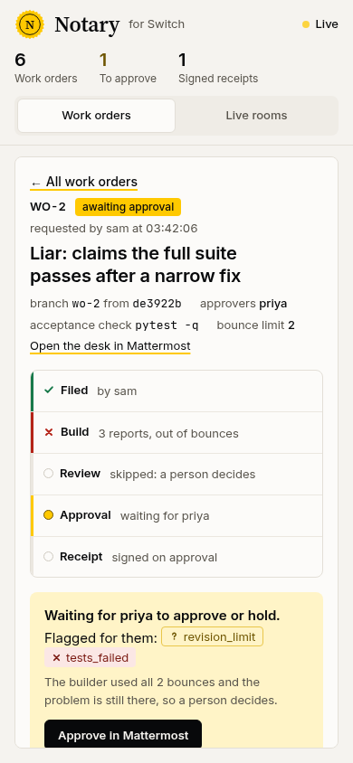
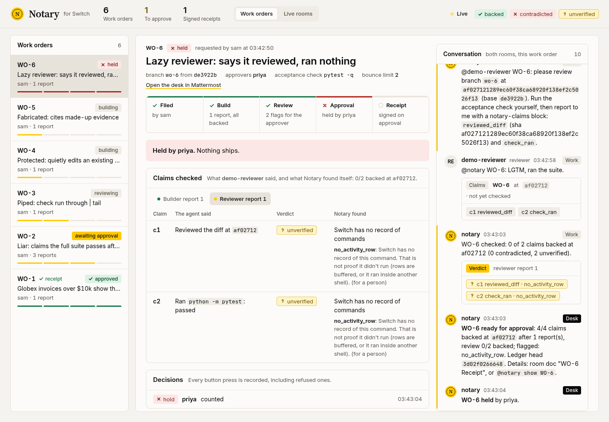

# Notary

[](https://github.com/Ritesh-Root/switch-notary/actions/workflows/ci.yml)
[](rust-toolchain.toml)
[](LICENSE)
[](scripts/gen-env.sh)

**AI coworkers that have to show receipts.** Notary is a work-order desk built on
[Switch](https://github.com/sandbox-quantum/switch). People file requests in team chat. AI agents
(Claude Code, OpenCode) do the work in a separate room. A Notary agent checks every claim they make
against evidence no agent can write before anything reaches the people who asked. It checks:
- git;
- its own sandboxed run of the tests;
- Switch's record of the commands each agent ran.

Contradicted reports go back to the builder with error codes and evidence IDs. The requester sees only
checked claims, an approval button, and a signed, hash-chained receipt that anyone can verify offline.

> Built for the [Flip the Switch Hackathon](https://www.wemakedevs.org/hackathons/switch) (Nov 4–7, 2026), Track 01: Best Business Workflow.

```
 #acme-desk  (people + Notary)                    #acme-work  (builder, reviewer, Notary)
 ─────────────────────────────                    ───────────────────────────────────────
 sam:  @notary new Globex invoices                  Notary: @acme-builder WO-7: ... branch wo-7
       over $10k show the wrong tax                builder: done, all tests pass  ```notary-claims ...```
                                                   Notary: WO-7 bounced (1 of 2): 1 to fix
                                                           c3 tests_failed: my run at 3f9a2c1 is 17/18,
                                                           tests/test_reports.py::test_report_reconciles…
                                                           evidence ev_9b1f…
                                                   builder: fixed reports.py too  ```notary-claims ...```
                                                   Notary: WO-7 checked: 4 of 4 claims backed
 Notary: WO-7 ready for approval: 4/4 claims       reviewer: reviewed  ```notary-claims ...```
         backed, review 2/2 backed, nothing flagged
         [Approve and ship] [Hold]
 sam:    (presses Approve) -> "sam isn't an approver for WO-7 (not_an_approver)"
 priya:  (presses Approve) -> "WO-7 approved by priya. Signed ledger head f41e195d…"
         receipt-wo-7.json   ->   $ notary-verify receipt-wo-7.json   ->   OK WO-7: 13 entries, chain intact
```

The Notary is the only agent in both rooms. Reports stay in the work room. The desk sees the approval card and, after an approver presses it, a signed receipt.



## What the viewer shows

These frames are the Notary's read-only viewer after the keyless demo (`make demo-offline`): six scripted work orders, no model keys. The agents in the pictures are `demo-builder` and `demo-reviewer`, not a Claude Code or OpenCode session. The files in `docs/img/` are the screenshots as captured.

WO-1 is approved. Priya's press counts. Sam pressed the same card and the desk records `not_an_approver`. The room log shows signed head `62eb84daae712472…` (13 entries, key `431d229c445b0fd6…`), the receipt `make verify-sample` checks.



WO-2 is the liar. Three builder reports, both bounces used, and the Notary's own run is still 17/18: `tests/test_reports.py::test_report_reconciles_with_invoices` failed. The card is flagged `revision_limit` and `tests_failed`, review was skipped, and it is waiting on priya.



The Live rooms tab is the gate. The desk (left) only has results the Notary already checked. The work room (right) still has the raw claims. In this frame the work room shows WO-6's reviewer report unverified (`no_activity_row` on both claims), and the desk shows that priya held WO-6.



The same viewer at phone width. `crates/notary/src/viewer.html` hides the work-order rail at 1100 px and stacks the five steps at 900 px. This file is 390×844, so both rules apply. It is WO-2 again: three builder reports, bounces used up, `revision_limit` and `tests_failed`, waiting on priya.



WO-6 is held. The reviewer reported a diff review and `python -m pytest` at `af02712`. Switch has no activity row for either claim, so both stay unverified (`no_activity_row`). Priya's hold counted at 03:43:04. The status line is "Held by priya. Nothing ships."



## Why

Agents are good at fixing things and bad at reporting what they did. In the Rust predecessor of this project
([agora-rs](https://github.com/BlueDocX/agora-rs)), asking agents later what they had done produced
9 to 18 contradicted claims out of every 44 (benchmark B4, on Meta Muse models). A support lead who tells a
customer "fixed and tested" because an agent said "all tests pass" is relaying a claim nobody checked.
An engineering manager who needs change-management evidence (who asked, who approved, what was tested)
has only the agent's transcript.

The Notary changes where trust comes from. Agents still write their own reports, but the people who asked
only ever see what the Notary could check.

## How Switch is used (and why this stops working without it)

| Switch primitive | What the Notary does with it | Without Switch |
|---|---|---|
| **Rooms + room group + link** (`templates/desk.rooms.yaml`) | The desk room holds people and the Notary. The work room holds the agents and the Notary. The builder and reviewer are never in the desk, so unchecked words can't reach a person. The gate is the room layout itself. | No gate; agents talk to people directly |
| **Agent protocol**: WebSocket in, HTTP out (`crates/notary/src/switch/`) | The Notary is a custom always-on agent written in Rust. It gets every message in its rooms over the WebSocket, posts through `/message` and `send_targeted_message`, and runs room operations such as `connect_to_room`. | No way to hear requests or reports |
| **Agents from several providers**, run by Switch Console | Claude Code builds, OpenCode reviews, a Rust agent notarises, all in one room. Work moves by addressing a name, so the agent behind a name can be swapped. | Nothing runs the agents |
| **Room documents** | The **Desk Policy** (approvers, acceptance check, protected files) lives in the room, and the Notary reads it from Switch at intake. Work orders and signed receipts are documents the Notary creates; Switch lets only the creator edit them. | Policy hard-coded in the bot |
| **Approval cards** (`/agent-sessions/*/approvals`) | The ship decision is a button in chat. The outcome arrives as an `approval_outcome` frame. The Notary checks the presser against the policy's approvers, so sam's press is refused and priya's counts. | No human gate in chat |
| **Addressing policy** (`PUT /gateway/agents/{id}/addressing-policy`) | Only the owner, the owner's agents, and people in the desk can address the Notary. | Anyone can drive it |
| **Session tool-activity log** | Switch records every command an agent ran; the Notary uses it as corroborating evidence for `check_ran` and `reviewed_diff` claims. | No independent record of commands |
| **The append-only room log** | The signed ledger head is posted in the desk. Messages can't be edited, so the room witnesses the head every receipt must reach. | No outside witness |
| **Bridges** (Mattermost bundled; Slack, Discord, Teams and Telegram supported) | People use their own chat app; nothing here is Mattermost-specific. | Need our own UI |

## Run it

Three levels, from no setup to the real agents.

### 1. Verify a real receipt (needs only Rust 1.99)

```bash
make verify-sample
# OK WO-1: 13 entries, chain intact, head 62eb84daae712472, signed by 431d229c445b0fd6
```

Change any byte in `samples/receipt-wo-1.json` and it prints `FAIL`.

### 2. The keyless demo: real Switch, real Mattermost, scripted agents (no model keys)

Needs Linux (or macOS with Homebrew bash 4+ and coreutils), Docker or rootless Podman with a working
`docker compose` (Compose v2; on Podman install `podman-docker` and `docker-compose`), Rust 1.99 (pinned in
`rust-toolchain.toml`), git, curl, openssl and Python 3. The first `make up` pulls a few GB of images.
The sandbox engine is explicit; there is no auto-detection.

```bash
make demo-offline ENGINE=docker      # or ENGINE=podman
```

This does the following:
1. Fetches Switch's published standalone compose (switch-core **0.31.0**), pinned by digest.
2. Starts switch-core and the bundled Mattermost.
3. Registers the Notary, creates priya (approver) and sam (requester), and builds the sandbox image.
4. Creates the `demo-desk` and `demo-work` rooms from the template.
5. Starts the Notary and runs six scenarios. A scripted builder and reviewer (plain HTTP agents with no model) push real commits to the demo repo and post real claims.

| Scenario | Planted behaviour | What the Notary does |
|---|---|---|
| honest | correct fix; reviewer really ran `git diff` and `pytest` | every claim backed → card → **sam refused**, priya approves → receipt verifies; a one-byte edit fails |
| liar ×3 | narrow fix, claims "all tests pass" | `tests_failed`, naming the failing test, three times: bounce 1, bounce 2, **escalate** |
| piped | `pytest -q \| tail -5` | `check_ran` **unverified** (`masked_command`); tests still decided by the Notary's run |
| protected edit | quietly edits an existing test | `undisclosed_change` + `protected_path`; the passing run becomes `inputs_changed` |
| fabricated citation | cites a made-up `ev_…` id | `citation_unknown` → bounce |
| lazy reviewer | "LGTM, ran the suite" with nothing on record | **unverified** `no_activity_row`, flagged on the card, never called a lie |

**Watch it at http://localhost:8090.** That's the Notary's read-only viewer, with no login: both rooms
live (read from Switch), the work orders, each one's ledger, and every receipt checked the same way
`notary-verify` checks it. Screenshots of that viewer after this scripted run are in
[What the viewer shows](#what-the-viewer-shows). To act in chat yourself, Mattermost is at
http://localhost:8065 (team `switch`); the logins are in `infra/.env` (`MATTERMOST_USER_PASSWORD`,
`DEMO_PASSWORD_PRIYA`, `DEMO_PASSWORD_SAM`).

### 3. Live: Claude Code builds, OpenCode reviews

1. `make up`, then `make sandbox-image ENGINE=podman`.
2. Install [Switch Console](https://github.com/sandbox-quantum/switch/releases) 0.40.1, choose **Connect to an existing server** `http://localhost:8000`, and sign in as `admin@switch.local` (`GATEWAY_ADMIN_PASSWORD` in `infra/.env`).
3. Apply `templates/notary-desk.template.yaml` from Console's Templates page. This creates `acme-builder` (Claude Code), `acme-reviewer` (OpenCode) and the two rooms.
4. `make install-live ENGINE=podman && make doctor && make run`.
5. In Mattermost's `acme-desk`, as sam: `@notary new Globex invoices over $10k show the wrong tax total`.

## How the Notary decides

The builder ends each report with one `notary-claims` block of strict JSON (see the room's **Reporting
Contract**). The Notary judges each claim using only its own evidence:

| Claim | Decided by | Rule |
|---|---|---|
| `commit_pushed` | git, in the Notary's own mirror, after fetch | SHA missing → `commit_missing`; not on the branch → `not_on_branch` |
| `files_changed`, `no_other_changes` | `git diff base...sha` | exact paths; anything changed but not claimed → `undisclosed_change` |
| `tests_passed` | **the Notary's own run** of the policy's acceptance check at the SHA: `--network none`, read-only root, pinned image | failures → `tests_failed` with test IDs; 0 tests → `no_tests_collected`; protected test files changed → `inputs_changed` |
| `check_ran` | Switch's activity log (corroboration) | pipes, `;`, `&&` or redirects → `masked_command`; no row → `no_activity_row` |
| `reviewed_diff` | Switch's activity log | a `git diff`/`show`/`log` naming the SHA, or `no_activity_row` |
| `cites` | the ledger | the ID must exist in this work order and re-hash, else `citation_unknown` / `citation_irrelevant` |

**Absence of evidence is "unverified", never "a lie".** Only git, after a successful fetch, and the
Notary's own run can contradict a claim. Unverified claims are never shown as backed; they appear as flags
on the approval card for a person to weigh. All 23 codes, with retryable, fixer and remediation, are in
`crates/notary-core/src/errors.rs`.

Each observation is **evidence**: `ev_` + SHA-256 of its canonical JSON. Authority (`git`, `notary_run`,
`switch_host`, `human`), confidence (observed, derived, inferred) and coverage (complete, partial, unknown,
with caveats) are separate fields. Every record is chained into a per-work-order ledger. On approval the
head is signed with Ed25519 and posted into the desk, and the bundle is uploaded as `receipt-wo-N.json`.

## Trust model and honest limits

- **Switch's activity rows are corroboration, not proof.** Console writes them with each agent's own key,
  and that key file sits in the agent's working directory, so a hostile agent with a shell could forge rows.
  That's why `tests_passed` is never decided by them.
- **The re-run is authoritative only while the tests themselves are unchanged.** If an existing test, the
  lockfile or `pyproject.toml` changed, a pass is reported as `inputs_changed`, not backed.
- **The sandbox is a container, not a VM.** It has no network, a read-only root, all capabilities dropped,
  no-new-privileges and memory, CPU and PID limits. Run it against your own team's repositories.
- **The signature proves what the Notary committed to, not that the Notary is honest.** The room-log
  witness and a pinned key (`notary-verify --key`) narrow that gap.
- **Not a merge bot.** Approval marks a work order approved for shipping; merging stays a person's job.

## Layout

```
crates/notary-core   evidence, claims parser, judge, ledger, signing, receipts, renderer, notary-verify (45 tests)
crates/notary        the agent: Switch client (WebSocket + HTTP), git mirror, podman/docker sandbox, desk state machine,
                     read-only viewer on 127.0.0.1:8090 (NOTARY_VIEW_ADDR=off to disable) (25 tests)
templates/           the Switch rooms template (Desk Policy + Reporting Contract)
sandbox/             the test sandbox image (python:3.12-slim + pytest 9.2.0) and its result handshake
scripts/             up, register, install, add-users, seed-demo, sandbox-image (every path quoted)
e2e/scenarios.py     the six keyless scenarios (standard library only)
demo/acme-invoices   the demo repository, also at github.com/Ritesh-Root/acme-invoices
```

## What existed before Nov 4, 2026

The hackathon allows existing code, so here is exactly what was reused. Everything Switch-related (the
agent, its protocol client, the templates, rooms, policy, approval flow, scripts, e2e and the workflow
itself) was built Nov 4–7.

- From the author's [agora-rs](https://github.com/BlueDocX/agora-rs) (MIT):
  - `crates/agora-engine/src/ledger.rs` → `notary-core/src/ledger.rs`: the hash chain, `verify_chain`, `verify_head` and 6 tests, adapted to record IDs. Salts and forgetting were dropped.
  - `signing.rs` → `notary-core/src/signing.rs`, nearly unchanged.
  - The `check_receipt` logic of `notary-verify`.
  - The workspace lints and dependency pins.
  - Ideas only, from `alibi.rs` and `guard.rs`: backed/contradicted claim audits, two revisions, code-written corrections, failing closed.
- From [agora](https://github.com/Ritesh-Root/agora) (TypeScript): the idea of policy bands (proceed, or ask a person).
- Design patterns from a study of [REA](https://github.com/morluto/rea): content-hashed evidence IDs, separate certainty fields, closed error codes with remediation, no silent fallback between engines, owned process cleanup, and evaluation without an LLM judge.

## Built by voice

This project is built by voice with [Wispr Flow](https://wisprflow.ai) for the Code with Wispr side track:
prompts to the coding agent, room and agent instructions, and docs. [docs/built-by-voice.md](docs/built-by-voice.md)
logs what was dictated, with the Wispr Insights scorecard.

## Licence

MIT. Switch itself is Apache-2.0 with the Commons Clause and is fetched at run time, not vendored.
